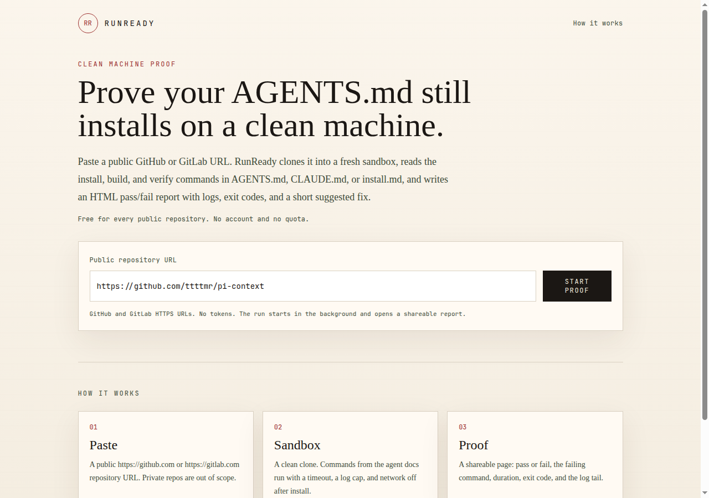

# RunReady

[](https://gitlab.com/antonyvo/runready/-/commits/main)
[](https://github.com/voantony/runready/releases/latest)
[](LICENSE)
[](https://nodejs.org/)

Prove a public repository's agent docs still install on a clean machine.

Paste a GitHub or GitLab HTTPS URL. RunReady clones it, reads `AGENTS.md`, `CLAUDE.md`, or `install.md` (and falls back to the README install or development section, including one linked `CONTRIBUTING.md`), runs the install, build, and verify commands, and stores a shareable pass/fail report. When the proof fails, or the commands were only in the README, the report drafts a patch: an updated agent doc, `scripts/agent-check`, and a GitLab CI or GitHub Actions workflow.

RunReady is free. There is no account, no quota, and no payment.

## Quick start

Requirements:

- Node.js 22 or newer
- `git`
- Linux `unshare` and `setpriv` from util-linux, or a working Docker daemon

```bash
git clone https://github.com/voantony/runready.git
cd runready
npm ci
cp .env.example .env.local   # optional
npm test
npm run dev
```

Open http://localhost:3000 and paste a public URL, for example:

- https://github.com/ttttmr/pi-context
- https://gitlab.com/antonyvo/koreader-library-gui

The form returns immediately. The report page polls until the run finishes. The run record is stored in `data/runready.sqlite`, which is gitignored.

`package.json` sets `"private": true` so this application is not published to npm. The source is [MIT](LICENSE).

## How to run

The default sandbox is `auto`: Docker when `docker info` succeeds, otherwise an `unshare` user, mount, and pid namespace. The unshare runner uses the host toolchain (Node, LuaJIT, `make`, and so on), masks `/home` and `/root`, drops capabilities, and turns the network off for build and verify. Install commands may use the network. Host environment variables are not passed in.

```bash
RUNREADY_SANDBOX=unshare npm run dev
RUNREADY_SANDBOX=docker npm run dev
```

Docker mode runs `node:22-bookworm` unless `RUNREADY_DOCKER_IMAGE` is set. That image has Node, not LuaJIT. Use `unshare` when the repository needs a host tool the image does not contain.

`GITHUB_TOKEN` and `GITLAB_TOKEN` are optional. With one set, the report can open a pull request or merge request. Without one, it still offers a patch download. Leave them empty in `.env.example`. Do not commit a filled-in `.env` file.

Each command has a timeout (`RUNREADY_COMMAND_TIMEOUT_MS`, default 180s) and a log cap (`RUNREADY_MAX_LOG_BYTES`, default 200k, tail kept). Commands must match an allowlist (`npm`, `make`, `luajit`, `cargo`, and the other package and test tools in `src/lib/safety.ts`). Pipes, redirects, `sudo`, absolute paths, and secret-like environment names are refused.

## Demo

The same pipeline the server uses can write a static report:

```bash
npm run proof -- https://github.com/ttttmr/pi-context /tmp/runready-demo
```

Checked-in examples from public repositories:

- [examples/github-pi-context.html](examples/github-pi-context.html) — `ttttmr/pi-context` passed from `AGENTS.md` (`npm install`, `npm run typecheck`, `npm test`, 76 tests).
- [examples/gitlab-koreader-library-gui.html](examples/gitlab-koreader-library-gui.html) — `antonyvo/koreader-library-gui` passed after a README fallback (`make zip VERSION=0.3.0`, `luajit spec/run.lua`, 508 tests). The fix patch is [examples/gitlab-koreader-library-gui.patch](examples/gitlab-koreader-library-gui.patch).



This tree was checked by running that command against `ttttmr/pi-context` (unshare sandbox, about 19s):

```text
run d415c3b0-8fc5-471c-87a3-aab26ecf9621 https://github.com/ttttmr/pi-context.git
status passed sandbox unshare duration 18763ms
  passed  exit=  0 clone   git clone --depth 1 https://github.com/ttttmr/pi-context.git
  passed  exit=  0 install npm install
  passed  exit=  0 verify  npm run typecheck
  passed  exit=  0 verify  npm test
wrote /tmp/runready-demo.json and /tmp/runready-demo.html
```

## How a run executes

`POST /api/runs` inserts a row and returns the report URL. `src/lib/queue.ts` is the scheduling seam: it calls `executeRun` on the Node process after the response. Swap `enqueueRun` for a worker later without changing the clone, parse, or sandbox steps.

## Fix request

When a proof fails, or it passes but the commands were missing from `AGENTS.md`, `CLAUDE.md`, or `install.md`, the report offers a fix:

- an updated agent doc with the commands that actually passed
- `scripts/agent-check`, which re-runs those commands
- `.gitlab-ci.yml` for a GitLab project, or `.github/workflows/runready.yml` for a GitHub project

Download the patch from the report, or `GET /api/runs/<id>/patch`. Apply it on a branch named `runready/agent-check-<id prefix>` and push it yourself.

If the matching token is set on the server, **Open pull request** commits the files and opens the request. The button still says "pull request" for GitLab; see [ISSUES.md](ISSUES.md). The token is not stored. If it cannot push to the upstream project, RunReady forks and opens the request from the fork.

A proof that already passes from a complete `AGENTS.md` does not draft a change.

## Roadmap

The product is free. These are the next pieces, in the order they help someone else extend it. Starter tasks with file paths and acceptance criteria are in [ISSUES.md](ISSUES.md).

- **Tell the truth on the report.** Name a GitLab fix a merge request, and list commands the six-command cap did not run.
- **Read more ecosystems.** `dotnet` is allowed in the sandbox and ignored by the parser. The same gap will show up for other tools that are already safe to exec.
- **Follow the doc the README actually links.** `HACKING.md` and `DEVELOPING.md` are invisible today.
- **Survive a restart.** The queue is an in-memory `setTimeout`. A proof left `running` should become an error instead of polling forever.
- **Later, not starters.** A worker so proofs outlive the web process, sandbox images that are not Node-only, and a status badge a repository can embed. Private repositories stay out of scope until there is an OAuth design that does not collect tokens in the browser.

## Contributing

See [CONTRIBUTING.md](CONTRIBUTING.md). GitLab CI is [`.gitlab-ci.yml`](.gitlab-ci.yml).

## License

[MIT](LICENSE) © 2026 Antony Vo.

Direct dependencies are MIT. Transitive packages are MIT, ISC, BSD, Apache-2.0, or CC-BY-4.0 (`caniuse-lite`, via Autoprefixer). There is no GPL or AGPL dependency.

`next` optionally installs `sharp`, which downloads libvips builds under `@img/sharp-libvips-*` (LGPL-3.0-or-later) and `@img/sharp-wasm32` (Apache-2.0 AND LGPL-3.0-or-later AND MIT). RunReady does not import `sharp`. Those binaries are weak copyleft: if you redistribute `node_modules` or an image that contains them, follow the LGPL-3.0 terms for libvips. The RunReady source stays MIT.
